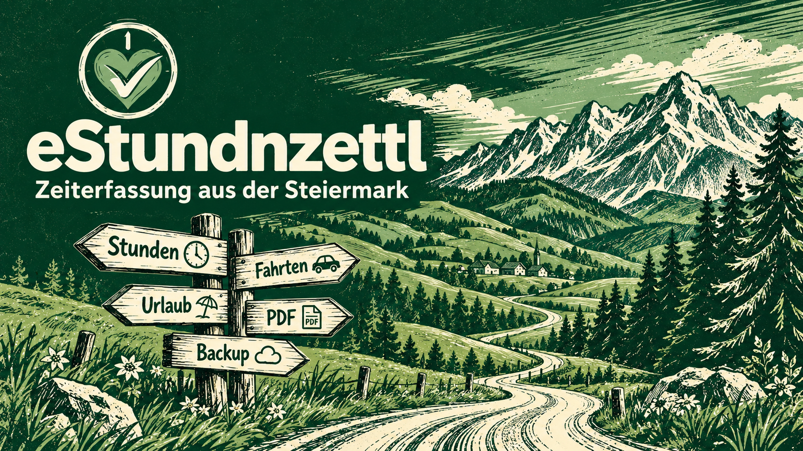
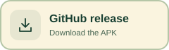
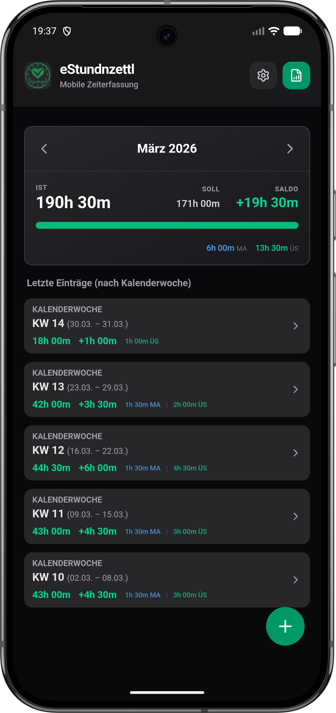
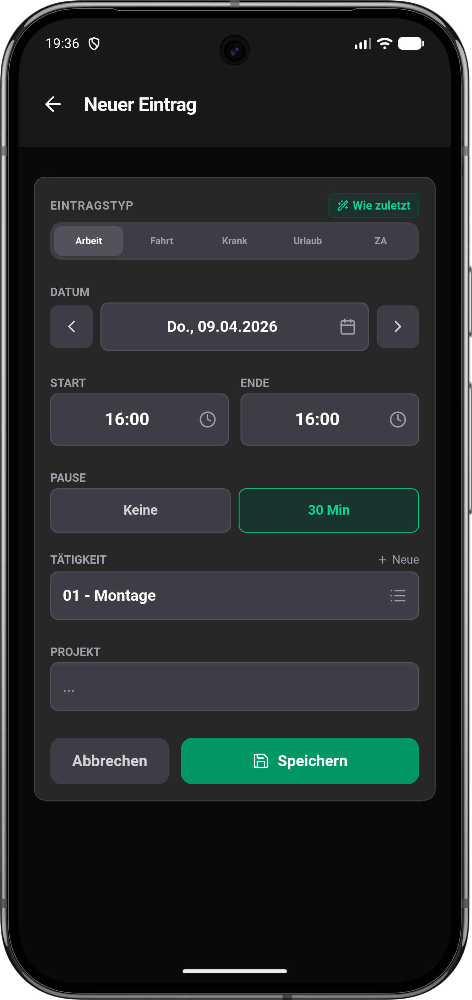
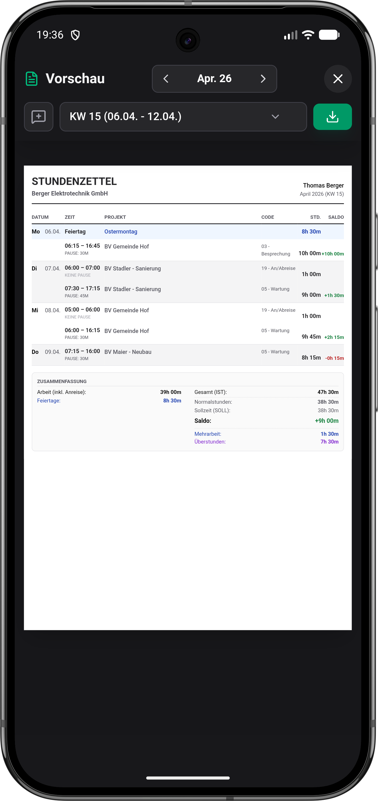

<p align="center">
  <a href="./README.md">Deutsch</a> · <strong>English</strong>
</p>

<p align="center">
  
</p>

<p align="center">
  <strong>🏔️ A little timesheet app from Styria, Austria.</strong><br />
  Hours, travel and time off on your phone. A proper PDF at the end of the month. Done. ✅<br />
  Free. No ads, no subscription, no app account.
</p>

<p align="center">
  <a href="https://play.google.com/store/apps/details?id=com.estundnzettl.app"></a>
  <a href="https://github.com/D3rPaPaH0d3n/eStundnzettl/releases/latest"></a>
  <a href="https://d3rpapah0d3n.github.io/eStundnzettl/"></a>
</p>

<p align="center">
  <a href="https://github.com/D3rPaPaH0d3n/eStundnzettl/releases/latest"></a>
  <a href="https://github.com/D3rPaPaH0d3n/eStundnzettl/actions/workflows/ci.yml"></a>
  <a href="./LICENSE"></a>
</p>

## 🌲 Servus! Let’s not lose a single hour.

Jot down your hours, add the journey, find that work receipt again.

*The usual paperwork shuffle.* eStundnzettl keeps it together on your phone, so the end of the month doesn’t turn into a treasure hunt.

A personal project by **Markus from Styria** — *put together with care and a bit of tinkering.*

For **tradespeople, site work** or anyone who wants to know where their working hours went.

Record **hours, breaks, travel and time off**. The app turns them into a **weekly or monthly PDF report**.

> 🔒 **Your data stays on your device.**
>
> No internet or app account needed to record your time. You can back up to your own cloud too — *if you want to.*

## 📸 Here’s what it looks like

<p align="center">
  
  
  
</p>

<p align="center"><em>Hours in view · Entry done · PDF ready. Sorted. ✅<br />Screenshots show German; the app also speaks English.</em></p>

## 🆕 Fresh from the workshop

Checked against **[GitHub v5.2.8](https://github.com/D3rPaPaH0d3n/eStundnzettl/releases/tag/v5.2.8)**.

*The Play Store shows the version available there.*

The latest rounds of tinkering have focused on **documents and backups**:

### 📎 Documents travel with your backup

Since **5.2.8**, backups include the **actual files** — not just their metadata.

That applies to Google Drive, Nextcloud, local folders and exports.

> **15 MB of documents per backup** — *newest first.*

### 📷 Smaller photos, better sharing

- Photos are **automatically resized and rotated correctly**.

- When sharing through WhatsApp and similar apps, **photos go along as PDFs**.

- **A different app, just this once?** If a preferred sharing app is set, long-press **Share** to open the app chooser for this one send.

### 📄 Receipts inside the timesheet

**Sick notes, work records and other documents** can be added as extra pages at the end of the PDF.

They also appear in the **preview** and **automatic archive**.

*You can switch this off in power-user mode.*

## 🧰 What this little helper can do

<table>
  <tr>
    <td width="50%" valign="top">
      <h3>⏱️ Hours &amp; breaks</h3>
      <p>Record by hand or with the <strong>live timer</strong>.</p>
      <p>Reuse earlier times with <em>“Same as last”</em>.</p>
    </td>
    <td width="50%" valign="top">
      <h3>🎯 Your work schedule</h3>
      <p>Full-time, part-time, a four-day week or your own schedule.</p>
      <p><strong>Target · Recorded · Balance</strong><br>All three at a glance.</p>
    </td>
  </tr>
  <tr>
    <td width="50%" valign="top">
      <h3>🏖️ Vacation &amp; time in lieu</h3>
      <p><strong>Vacation, sick leave &amp; time in lieu</strong><br>See vacation taken, planned and remaining — including half days.</p>
      <p><strong>Optional time-in-lieu account</strong><br>Carry the balance into the next month and record paid-out overtime.</p>
    </td>
    <td width="50%" valign="top">
      <h3>🗓️ No day forgotten</h3>
      <p>Spot and fill in missing workdays.</p>
      <p><strong>“Day off” = 0 hours</strong><br>No deduction from time in lieu.</p>
      <p><em>A free Friday?</em> After meeting the weekly target, it isn’t treated as forgotten.</p>
    </td>
  </tr>
  <tr>
    <td width="50%" valign="top">
      <h3>🚐 Travel &amp; site work</h3>
      <p>Keep arrival/departure separate from other travel time.</p>
      <p>Mark <strong>overnight stays</strong> and see their count in the monthly PDF.</p>
      <p><em>Expenses are not calculated automatically.</em></p>
    </td>
    <td width="50%" valign="top">
      <h3>📎 Documents &amp; PDFs</h3>
      <p><strong>Photos &amp; documents</strong><br>Keep them with the relevant entry.</p>
      <p><strong>Weekly or monthly PDFs</strong><br>With document pages, an optional company logo and a custom footer. Save and share.</p>
    </td>
  </tr>
  <tr>
    <td width="50%" valign="top">
      <h3>☁️ Back up &amp; restore</h3>
      <p><strong>Local · Google Drive · Nextcloud</strong></p>
      <p>Choose your backup and review it before restoring.</p>
      <p><em>No signal?</em> Cloud uploads are retried when the network is back — even after leaving the app.</p>
    </td>
    <td width="50%" valign="top">
      <h3>🏔️ Local rules</h3>
      <p>Holidays for <strong>Austria</strong>, German states and Swiss cantons.</p>
      <p>Adjust working-time and break rules to suit your needs.</p>
    </td>
  </tr>
  <tr>
    <td width="50%" valign="top">
      <h3>🌙 After hours too</h3>
      <p>German &amp; English. Plus: <strong>dark mode</strong>.</p>
      <p>Guided setup and demo data.<br><em>Take a relaxed look around first.</em></p>
    </td>
    <td width="50%" valign="top">
      <h3>🔧 The tinkerer’s corner</h3>
      <p><strong>Nextcloud, PDF display options and automatic PDF archives</strong> live in power-user mode — our German “Hausmasta-Modus”.</p>
      <p><em>Just recording hours?</em><br>No need to explore every extra.</p>
    </td>
  </tr>
</table>

**Custom activity codes** are available *without* power-user mode too.

Don’t need target/actual calculations? Choose **“Record only”**.

> 💡 **Your settings matter.**
>
> Calculations depend on them. Do check that they fit your employment arrangements.

## 🚀 Let’s get you started

1. **Install**

   Use [Google Play](https://play.google.com/store/apps/details?id=com.estundnzettl.app) or download the APK from [GitHub Releases](https://github.com/D3rPaPaH0d3n/eStundnzettl/releases/latest).

   Requires **Android 8.0 or later**. For an APK, Android asks you to allow installation from your chosen source.

2. **Set up**

   Enter your name, company if needed, work schedule and region. **Backup is optional.**

   *Just having a look? Demo data lets you take a relaxed test run.*

3. **Record**

   Tap **+** to add an entry or use the **live timer**. Add travel, time off and supporting documents as needed.

4. **Finish**

   Open the report, choose a **month or calendar week**, then save the PDF or share it through an app of your choice.

Find changes in **Settings → Changelog** in the app and in [GitHub Releases](https://github.com/D3rPaPaH0d3n/eStundnzettl/releases).

*The release badge above refers to GitHub — not the current Play Store version.*

## 💾 Your data. Your backup. Your choice.

- **Local first**

  Work records stay on your device. Time tracking needs neither internet nor an app account.

  *No ads. No usage analytics.*

- **Your choice of backup**

  A local folder, your Google Drive or your Nextcloud. Automatic backups and a monthly PDF archive are configurable.

  *Nextcloud is set up in power-user mode.*

- **Documents in backups**

  The actual files are included too: **up to 15 MB in total per backup**, newest first.

  Keep separate copies of additional or larger original files. Files that were already missing before the backup need to be uploaded again.

- **No signal right now?**

  Cloud uploads are retried once a connection is available. Only **changed data** is uploaded.

  When restoring, choose your backup and review a summary first.

- **Share deliberately**

  Cloud backups and sharing reports are **your choice**. Check included receipts and personal details before sending.

**Important:** Without a separate backup, device loss or uninstalling the app can mean losing your data.

Read more in the [privacy policy](./docs/privacy.html) (German).

## 🛠️ Under the bonnet & lending a hand

The current app lives in [`native/`](./native/).

**Kotlin · Jetpack Compose · Material 3 · Room**

- **`:core`** — models, calculations and the backup format; independent of Android.

- **`:app`** — Android UI, storage, cloud connections and native PDF generation.

### Build & test locally

Use **Android Studio**, the matching **Android SDK** and **JDK 21**, as used in [CI](./.github/workflows/ci.yml).

Project conventions and build notes are in [`CLAUDE.md`](./CLAUDE.md) (German).

```sh
cd native
./gradlew :core:test :app:testBetaDebugUnitTest :app:testProdDebugUnitTest
./gradlew :app:assembleBetaDebug :app:assembleProdDebug
```

*On Windows, replace `./gradlew` with `.\gradlew.bat`.*

- **`beta`** — internal testing and open beta, including the diagnostics card in power-user mode. The default flavor.

- **`prod`** — production and GitHub releases, without the diagnostics card. Verbose debug logging is removed in release builds.

- **Coverage** — `./gradlew :core:koverHtmlReport` generates the report in `native/core/build/reports/kover/html/`.

The former Capacitor app is archived in the [`legacy/capacitor-4.5.x`](https://github.com/D3rPaPaH0d3n/eStundnzettl/tree/legacy/capacitor-4.5.x) branch.

## 💬 A question, an idea — or something playing up?

**Let’s hear it!** GitHub is the place for feedback and bug reports.

If something isn’t working, these help:

- **App and Android versions**
- **Steps to reproduce**
- A **screenshot without personal information**, if useful

Prefer a direct message, or have a licensing question? **You can reach Markus by email too.**

<p align="center">
  <a href="https://github.com/D3rPaPaH0d3n/eStundnzettl/issues"></a>
  <a href="mailto:project@kainer.co.at"></a>
</p>

## ☕ Buy the tinkerer a coffee

eStundnzettl is free — **no ads, no subscription, no catch**.

If it saves you a little paperwork, you can buy Markus a coffee:

<p align="center">
  <a href="https://revolut.me/mkainer/pocket/QAt1Q0Ntsb">
    
  </a>
</p>

*Entirely optional.* As we say in Styria: “Vergelt’s Gott!” — a heartfelt thank you. 😄

## 📄 License & branding

**Source code → [MIT License](./LICENSE)**

Keep the copyright notice and license text when reusing it.

**The name, logo, screenshots and branding** are excluded. See the [Trademark & Branding Policy](./TRADEMARK.md).

*Forks are welcome — with your own name and logo.*

---

<p align="center">
  Tinkered together with heart, thought and a little AI by <strong>Markus Kainer</strong>. 🌲<br />
  <em>🏔️ Damit ka Stund verloren geht! — So no hour gets lost.</em>
</p>
