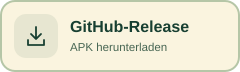

<p align="center">
  <strong>Deutsch</strong> · <a href="./README.en.md">English</a>
</p>

<p align="center">
  
</p>

<p align="center">
  <strong>🏔️ Der digitale Stundenzettel aus der Steiermark.</strong><br />
  Stunden, Fahrten und Urlaub am Handy. Am Monatsende a g’scheites PDF. Fertig. ✅<br />
  Gratis. Ohne Werbung, ohne Abo, ohne App-Konto.
</p>

<p align="center">
  <a href="https://play.google.com/store/apps/details?id=com.estundnzettl.app"></a>
  <a href="https://github.com/D3rPaPaH0d3n/eStundnzettl/releases/latest"></a>
  <a href="https://d3rpapah0d3n.github.io/eStundnzettl/"></a>
</p>

<p align="center">
  <a href="https://github.com/D3rPaPaH0d3n/eStundnzettl/releases/latest"></a>
  <a href="https://github.com/D3rPaPaH0d3n/eStundnzettl/actions/workflows/ci.yml"></a>
  <a href="./LICENSE"></a>
</p>

## 🌲 Servus! Damit ka Stund verloren geht.

Stunden notieren, die Fahrt dazurechnen, den Regieschein wiederfinden — die übliche Zettelwirtschaft halt. eStundnzettl hält das am Handy zusammen, damit am Monatsende nicht die große Sucherei losgeht.

Ein persönliches Projekt von **Markus aus der Steiermark**, mit Herz und Hirn ausgetüftelt. Fürs Handwerk, die Montage oder einfach für alle, die wissen möchten, wo ihre Arbeitsstunden geblieben sind. Du erfasst Stunden, Pausen, Fahrten und Abwesenheiten; die App macht daraus einen Wochen- oder Monatsbericht als PDF.

**Deine Daten bleiben auf deinem Gerät.** Internet und App-Konto brauchst du fürs Erfassen nicht. Eine Sicherung in deine eigene Cloud geht natürlich auch — wenn du magst.

## 📸 So schaut’s aus

<p align="center">
  
  
  
</p>

<p align="center"><em>Stunden im Blick · Eintrag erledigt · PDF fertig. Passt. ✅</em></p>

## 🆕 Frisch aus der Werkstatt

**Abgeglichen mit [GitHub v5.2.8](https://github.com/D3rPaPaH0d3n/eStundnzettl/releases/tag/v5.2.8).** Den jeweiligen Play-Store-Stand zeigt der Store selbst.

Die letzten Runden haben vor allem die Belege und Backups auf Vordermann gebracht:

- **Dokumente reisen im Backup mit:** Seit 5.2.8 werden auch die Dateien gesichert, nicht bloß ihre Eckdaten — auf Google Drive, Nextcloud, im lokalen Ordner und beim Export. Bis insgesamt **15 MB Dokumente pro Backup**, neueste zuerst.
- **Fotos schlanker, Teilen g’scheiter:** Hochgeladene Fotos werden automatisch verkleinert und richtig gedreht. Beim Teilen über WhatsApp & Co. gehen Fotos als PDF mit. Ist eine feste Versand-App eingestellt, öffnet langes Drücken auf **Teilen** einmalig die Auswahl einer anderen App.
- **Belege direkt im Stundenzettel:** Krankmeldungen, Regiescheine und andere Dokumente können als zusätzliche Seiten hinten am PDF hängen — auch in der Vorschau und im automatischen Archiv. Im Hausmasta-Modus lässt sich das abschalten.

## 🧰 Was der kleine Helfer draufhat

<table>
  <tr>
    <td width="50%" valign="top">
      <h3>⏱️ Stunden &amp; Pausen</h3>
      <p>Von Hand oder mit Live-Timer erfassen. Mit <strong>„Wie zuletzt“</strong> frühere Zeiten übernehmen.</p>
    </td>
    <td width="50%" valign="top">
      <h3>🎯 Deine Arbeitszeit</h3>
      <p>Vollzeit, Teilzeit, Vier-Tage-Woche oder ganz individuell. <strong>Soll, Ist und Saldo</strong> im Blick behalten.</p>
    </td>
  </tr>
  <tr>
    <td width="50%" valign="top">
      <h3>🏖️ Urlaub &amp; ZA</h3>
      <p>Urlaub, Krankenstand und Zeitausgleich erfassen; genommenen, geplanten und übrigen Urlaub sehen, auch halbe Tage. <strong>ZA-Konto mit Übertrag zwischen Monaten</strong> und Buchung ausgezahlter Überstunden.</p>
    </td>
    <td width="50%" valign="top">
      <h3>🗓️ Kein Tag vergessen</h3>
      <p>Fehlende Arbeitstage sehen und nachtragen. <strong>„Frei“ zählt 0 Stunden</strong>, ohne ZA abzuziehen. Ein freier Freitag bei erfüllten Wochenstunden gilt nicht als vergessen.</p>
    </td>
  </tr>
  <tr>
    <td width="50%" valign="top">
      <h3>🚐 Fahrten &amp; Montage</h3>
      <p>An-/Abreise und separate Fahrtzeit trennen. <strong>Nächtigungen</strong> markieren und im Monats-PDF zählen lassen — Spesen werden nicht automatisch berechnet.</p>
    </td>
    <td width="50%" valign="top">
      <h3>📎 Belege &amp; PDF</h3>
      <p>Fotos und Dokumente direkt am Eintrag. <strong>Wochen- oder Monatsbericht</strong> mit Belegseiten, eigenem Firmenlogo und Fußzeile erstellen, speichern und teilen.</p>
    </td>
  </tr>
  <tr>
    <td width="50%" valign="top">
      <h3>☁️ Sicher ist sicher</h3>
      <p>Lokaler Ordner, Google Drive oder Nextcloud. Den <strong>Backup-Stand selbst wählen</strong> und vorab prüfen. Cloud-Sicherungen werden bei fehlendem Netz nachgeholt, auch nach dem Verlassen der App.</p>
    </td>
    <td width="50%" valign="top">
      <h3>🏔️ Hier daheim</h3>
      <p>Feiertage für <strong>Österreich, deutsche Bundesländer und Schweizer Kantone</strong>. Arbeitszeit- und Pausenregeln passend einstellen.</p>
    </td>
  </tr>
  <tr>
    <td width="50%" valign="top">
      <h3>🌙 Auch nach Feierabend</h3>
      <p>Deutsch und Englisch, <strong>Dark Mode</strong>, geführte Einrichtung und Demo-Daten zum gemütlichen Ausprobieren.</p>
    </td>
    <td width="50%" valign="top">
      <h3>🔧 Der Hausmasta</h3>
      <p>Für alle, die gern schrauben: <strong>Nextcloud, PDF-Felder und automatische PDF-Archive</strong>. Wer einfach Stunden erfassen will, muss nicht durch alle Extras.</p>
    </td>
  </tr>
</table>

Eigene Tätigkeitscodes sind auch ohne Hausmasta-Modus erreichbar. Du kannst auch **„Nur Aufzeichnung“** ohne Soll/Ist-Berechnung wählen. Die Berechnungen hängen von deinen Einstellungen ab — schau bitte, dass sie zu deinem Arbeitsverhältnis passen.

## 🚀 Los geht’s — ganz ohne Einschulung

1. **Installieren:** über [Google Play](https://play.google.com/store/apps/details?id=com.estundnzettl.app) oder die APK aus den [GitHub Releases](https://github.com/D3rPaPaH0d3n/eStundnzettl/releases/latest). Android 8.0 oder neuer wird benötigt. Für die APK erlaubt Android die Installation aus der gewählten Quelle nach deiner Bestätigung.
2. **Einrichten:** Name, bei Bedarf Firma, Arbeitszeitmodell und Region wählen. Backup ist optional. Noch nicht sicher? Mit den Demo-Daten kannst du erst einmal gemütlich reinschnuppern.
3. **Erfassen:** Über **+** einen Eintrag anlegen oder den Live-Timer nutzen. Fahrten, Abwesenheiten und Belege nach Bedarf ergänzen.
4. **Abschließen:** Den Bericht öffnen, Monat oder Kalenderwoche auswählen und das PDF speichern oder über eine App deiner Wahl teilen.

Änderungen und Versionshinweise stehen in der App unter **Einstellungen → Änderungsprotokoll** und in den [GitHub Releases](https://github.com/D3rPaPaH0d3n/eStundnzettl/releases). Der Release-Badge oben bezieht sich auf GitHub, nicht auf den aktuellen Play-Store-Stand.

## 💾 Deine Daten. Deine Sicherung. Deine Entscheidung.

- **Lokal zuerst:** Arbeitsdaten werden auf deinem Gerät gespeichert. Für die Zeiterfassung brauchst du weder Internet noch ein App-Konto; es gibt keine Werbung oder Nutzungsanalyse.
- **Backup nach Wahl:** Lokaler Ordner, dein Google Drive oder deine Nextcloud. Nextcloud wird im Hausmasta-Modus eingerichtet. Automatische Sicherungen und ein monatliches PDF-Archiv sind konfigurierbar.
- **Dokumente im Backup:** Die Dateien selbst werden mitgesichert — bis insgesamt **15 MB pro Backup**, neueste zuerst. Sichere weitere oder größere Originaldateien bei Bedarf separat. Dateien, die schon vor dem Backup gefehlt haben, bitte einmal neu hochladen.
- **Netz grad weg?** Cloud-Sicherungen werden nachgeholt, sobald wieder eine Verbindung besteht. Hochgeladen wird nur, wenn sich etwas geändert hat; beim Wiederherstellen wählst du den Backup-Stand und siehst vorab eine Zusammenfassung.
- **Bewusst teilen:** Cloud-Backups und das Weitergeben von Berichten sind deine Entscheidung. Prüfe vor dem Versand auch enthaltene Belege und persönliche Angaben.

Ohne separate Sicherung können Daten bei Geräteverlust oder Deinstallation verloren gehen. Mehr zum Umgang mit Daten: [Datenschutzerklärung](./docs/privacy.html).

## 🛠️ Unter der Haube & mitwerkeln

Die aktuelle App liegt unter [`native/`](./native/): **Kotlin, Jetpack Compose, Material 3 und Room**. `:core` enthält plattformunabhängige Modelle, Berechnungen und das Backup-Format; `:app` die Android-Oberfläche, Datenspeicherung, Cloud-Anbindung und native PDF-Erzeugung.

Nutze Android Studio mit passendem Android SDK und JDK 21 wie in der [CI](./.github/workflows/ci.yml). Die Projektregeln und Build-Hinweise stehen in [`CLAUDE.md`](./CLAUDE.md).

```sh
cd native
./gradlew :core:test :app:testBetaDebugUnitTest :app:testProdDebugUnitTest
./gradlew :app:assembleBetaDebug :app:assembleProdDebug
```

Unter Windows `./gradlew` durch `.\gradlew.bat` ersetzen.

- **`beta`** ist der Standard-Flavor für interne Tests und Open Beta, inklusive Diagnose-Karte im Hausmasta-Modus.
- **`prod`** ist der Flavor für Produktion und GitHub-Releases, ohne Diagnose-Karte; im Release-Build werden ausführliche Debug-Logs entfernt.
- **Coverage:** `./gradlew :core:koverHtmlReport` erzeugt den Bericht unter `native/core/build/reports/kover/html/`.

Die frühere Capacitor-App ist im Branch [`legacy/capacitor-4.5.x`](https://github.com/D3rPaPaH0d3n/eStundnzettl/tree/legacy/capacitor-4.5.x) archiviert.

## 💬 A Frage, a Idee — oder zwickt’s wo?

Dann her damit! Für Feedback und Fehlermeldungen ist bei GitHub Platz. Wenn etwas nicht klappt, helfen App- und Android-Version, die Schritte zum Nachstellen und bei Bedarf ein Screenshot **ohne persönliche Daten**. Lieber direkt schreiben oder eine Lizenzfrage? Der Markus ist auch per Mail erreichbar.

<p align="center">
  <a href="https://github.com/D3rPaPaH0d3n/eStundnzettl/issues"></a>
  <a href="mailto:project@kainer.co.at"></a>
</p>

## ☕ A Scherzl spendier’n

eStundnzettl is gratis — **kane Werbung, kei Abo, nix**. Wenn dir die App ein bisserl Zettelwirtschaft erspart, kannst du Markus ein Scherzl spendieren:

<p align="center">
  <a href="https://revolut.me/mkainer/pocket/QAt1Q0Ntsb">
    
  </a>
</p>

Is koa Muas. Aber a „Vergelt’s Gott“ hat noch nie geschadet. 😄

## 📄 Lizenz & Markenauftritt

Der **Quellcode** steht unter der [MIT-Lizenz](./LICENSE). Bei Weiterverwendung müssen Copyright-Vermerk und Lizenztext erhalten bleiben.

**Name, Logo, Screenshots und Markenauftritt** sind davon ausgenommen; es gilt die [Trademark & Branding Policy](./TRADEMARK.md). Forks sind willkommen — mit eigenem Namen und eigenem Logo.

---

<p align="center">
  Mit Herz, Hirn und a bisserl KI ausgetüftelt von <strong>Markus Kainer</strong>. 🌲<br />
  <em>🏔️ Damit ka Stund verloren geht!</em>
</p>
